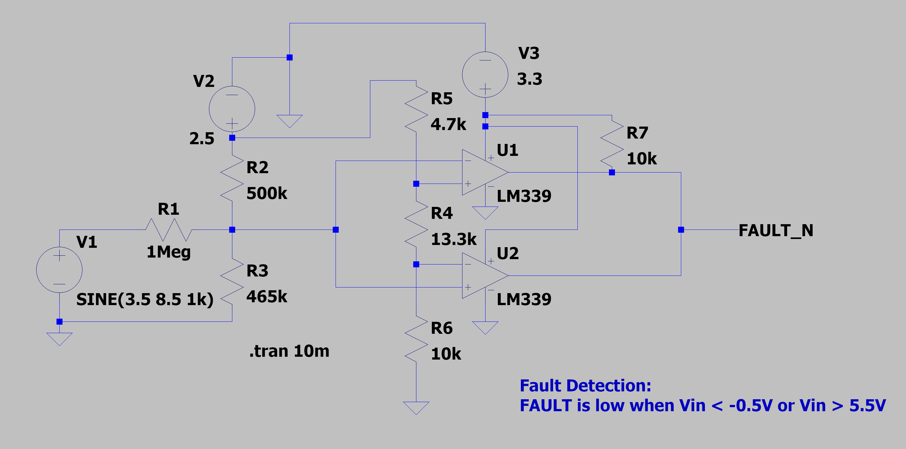

The goal of the fault detection circuit is to ensure that the input voltage is between -0.5 and 5.5 V. If the input is out of range, the fault LED should light up and the fault FPGA pin should be pulled high.

**Cricuit Structure**:

The probe should be able to handle any sustained voltage in the range -5V to 12V, so the fist goal of the fault detector is to scale this range to 0-3V3 (range of the comparators). Note that V1 is the probe input, and V2 is a 2.5V reference.

At the node of R1, R2, R3:
$$
\frac{V_N-V_1}{R_1} + \frac{V_N-V_2}{R_2} + \frac{V_N}{R_3} = 0 \\\quad\\
V_N(R_1R_2 + R_2R_3 + R_1R_3) = R_2R_3V_1+R_1R_3V_2 \\\quad\\
V_N = \frac{R_2R_3V_1 + R_1R_3V_2}{R_1R_2 + R_2R_3 + R_1R_3}
$$

Since the ciruit needs to be high impedance, R1 = 1Meg. To solve for R2 and R3, we just need to plug in the extremes, i.e.:

$$
\begin{align*}
V_1 = -5V &\Rightarrow V_N = 0V \\
V_1 = 12V &\Rightarrow V_N = 3.3V
\end{align*}
$$

$$
\begin{align*}
0 &= \frac{R_2R_3(-5) + 10^6R_3(2.5)}{10^6(R_2) + R_2R_3 + 10^6R_3} \\
R_2 &= 500k \\
3.3 &= \frac{5\cdot 10^5R_3(12) + 10^6R_3(2.5)}{10^6(5\cdot 10^5) + 5\cdot 10^5R_3 + 10^6R_3} \\
R_3 &= 465k
\end{align*}
$$

From here, U1 should compare $V_N$ with 5.5V input and the bottom one with -0.5V input. When the range [-5,12] is scaled to [0,3.3], -0.5 becomes 0.8735 and 5.5 becomes 2.038. From here we can simply calculate the values of the resistor ladder (fixing R6 = 10k):

$$
\begin{align*}
2.038 &= 2.5\frac{R_4+10^4}{R_4+R_5+10^4} \\
0.8735 &= 2.5\frac{10^4}{R_4+R_5+10^4}
\end{align*}
$$

We get:

$$
\begin{align*}
R_4 &= 13.3k \\
R_5 &= 4.7k
\end{align*}
$$